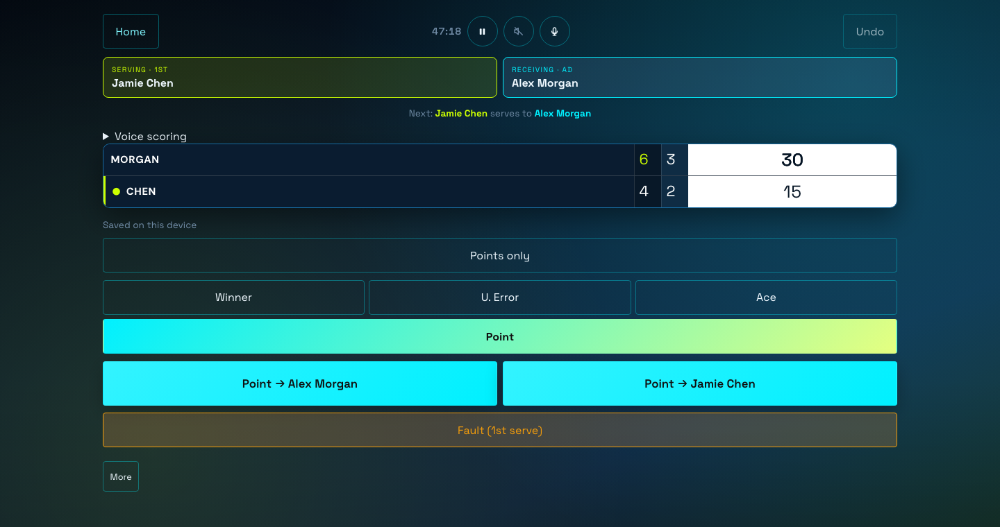
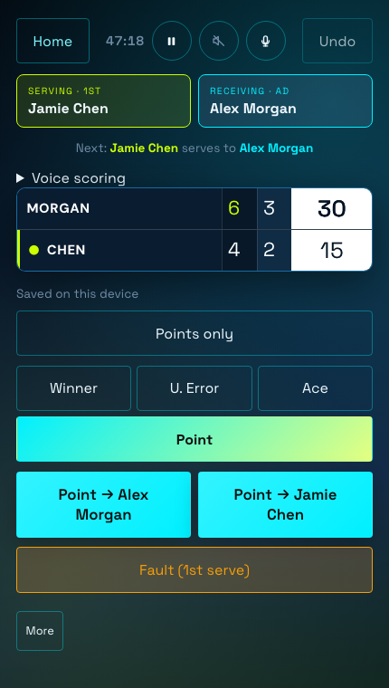

# SetPoint

**Offline tennis scoring. For your next game and your next level.**

Keep score in singles or doubles, follow the pressure points, and replay the match afterward. Start with two point buttons. Add statistics when you want more detail. SetPoint is for anyone who plays, with depth for competitive players working toward their next level.

**[Open the scorer](https://setpoint-tennis.vercel.app/app)** · [Explore SetPoint](https://setpoint-tennis.vercel.app) · [Help & feedback](https://github.com/sarthak7gupta/setpoint/issues)

No account. Your matches stay on your device. The web app works offline after its first successful load and cache.

<table>
  <tr><th>Desktop web</th><th>Mobile web</th></tr>
  <tr>
    <td width="72%" valign="top"></td>
    <td width="28%" valign="top"></td>
  </tr>
</table>

*Illustrative match data. Both screenshots use Hawk-Eye Pro with US Open colors.*

## Stay with the match

- **Score without the extra taps.** Points-only mode keeps the essentials close: award a point, log a fault, pause, or undo a mistake.
- **Let the rules follow the rally.** Singles and doubles, serve rotation, advantage or no-ad scoring, best of 1, 3 or 5, tiebreaks, and optional warm-up, changeover and ball-change timers.
- **Understand the important points.** Record optional winners, unforced errors and aces; explore serve, return and pressure statistics during the match or afterward.
- **See how the match unfolded.** A point-by-point recap, recent form, head-to-head and player history keep each match in context.
- **Keep people distinct.** Select an existing player profile or create a new person—even when two players share a name. Merge duplicate profiles explicitly when they belong to the same person.
- **Make it yours.** Four tournament-inspired atmospheres, six web design styles, a large landscape scoreboard, and English, Spanish, French and Hindi.
- **Take your records with you.** Export selected matches as a backup file and import them on another device. There is no automatic cloud sync.

## Your first match

1. [Open SetPoint](https://setpoint-tennis.vercel.app/app) and choose **New Match**.
2. Choose singles or doubles. Select existing profiles or enter new players.
3. Start scoring. Tap the winning side after each point; use **Undo** to correct a mistake.
4. Open **More** for statistics, recap and match settings. Return to **History** to resume an unfinished match.

Rules and timers are optional setup details. Quiet scoring keeps shot tags out of the way until you want them.

## Put SetPoint on your phone

**iPhone / iPad:** open the live scorer in Safari, let it load, then choose **Share → Add to Home Screen**.

**Android:** open the live scorer in your browser and use **Install app** or **Add to Home screen** from the browser menu when available.

Open the installed app once while connected before relying on it offline. Records belong to that browser or installation: export a backup before clearing browser data or changing devices. Offline scoring does not require an account.

The repository also includes native iOS and Android apps and wrist companions. These are source builds; there are currently no verified App Store, Play Store or binary-release downloads to link to. See [native build instructions](native/README.md).

## Voice and spectators

Spoken score announcements and tap-to-talk commands are available where the browser or native platform supports them. Voice recognition may require network access depending on that platform; offline scoring by touch remains available.

A second device on the same Wi-Fi can follow a read-only scoreboard when the scorer uses a compatible local host or native build. The public HTTPS web app cannot host a LAN scoreboard. Native LAN hosting, voice recognition and wrist integrations require a native development build.

App updates wait until all SetPoint tabs and installed-app windows are closed, so an update cannot interrupt an open match. Reopen the app while online to receive the new version.

Found a scoring issue or have a product suggestion? [Open an issue](https://github.com/sarthak7gupta/setpoint/issues) with the match format and steps to reproduce. Avoid attaching private match backups unless you intend to share their contents.
